<p align="center">
  
</p>

<h1 align="center">ClawChat</h1>

<p align="center"><b>내 서버에서 돌아가는, 프라이버시 우선 에이전트 할 일 앱.</b><br>
떠오른 일을 적어 두면 계획이 되고, 준비된 작업은 AI 에이전트가 맡고, 결과는 내가 검토합니다. 전부 내 서버 안에서.</p>

<p align="center">
  <a href="https://github.com/Topasm/clawchat/releases/latest"></a>
  <a href="https://github.com/Topasm/clawchat/actions/workflows/ci.yml"></a>
  <a href="LICENSE"></a>
  
</p>

<p align="center"><a href="README.md">English</a> · <b>한국어</b></p>

<picture>
  <source media="(prefers-color-scheme: dark)" srcset="docs/media/web-tasks-pane-dark.png">
  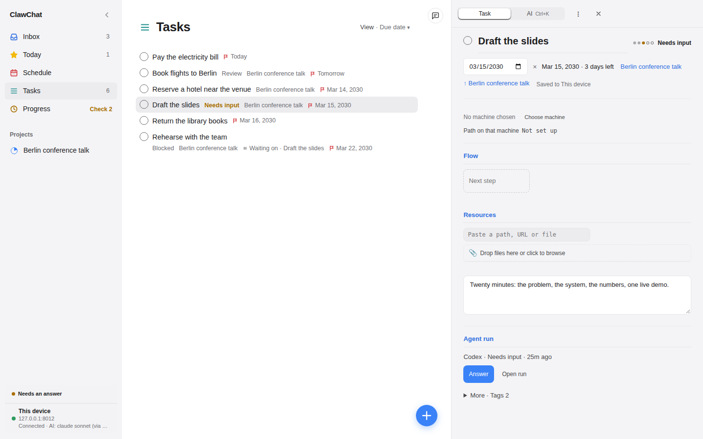
</picture>

<p align="center">
  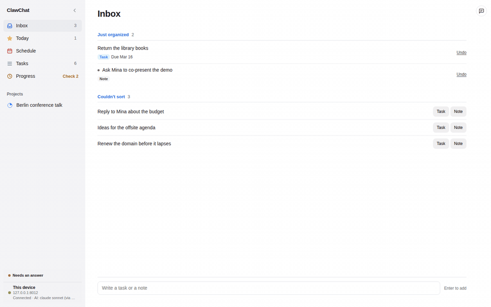
  <br><sub>받은함에 한 줄 적고, 작업을 열고, 에이전트가 남긴 질문에 답합니다.</sub>
</p>

## 왜 ClawChat인가

- **계획.** 목표와 받은함의 메모가 프로젝트, 단계, 선후 관계가 있는 계획이 됩니다. 다음에 할 수 있는 작업이 늘 보입니다.
- **실행.** 준비된 작업을 Claude Code, Codex CLI, Codex API, OpenCode, Ollama 또는 OpenAI 호환 모델로 실행합니다. 에이전트는 허용한 범위에서 웹 검색과 MCP 서버를 쓸 수 있습니다.
- **검토.** 모든 결과는 내 앞에서 멈춥니다. 승인하거나, 수정을 요청하거나, 에이전트의 질문에 답하면 다음에 준비되는 작업이 바로 보입니다.
- **내 손 안에.** FastAPI 서버 하나와 SQLite 파일 하나, 전부 내 것입니다. 위험한 변경은 명시적인 승인을 기다리고, 모델을 외부에 두지 않는 한 아무것도 내 기기를 떠나지 않습니다.

## 화면

<table>
  <tr>
    <td align="center"><b>받은함</b></td>
    <td align="center"><b>오늘</b></td>
  </tr>
  <tr>
    <td><picture><source media="(prefers-color-scheme: dark)" srcset="docs/media/web-inbox-dark.png">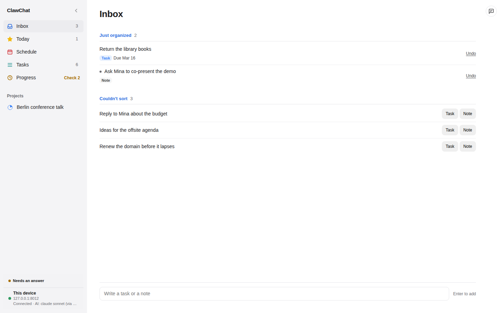</picture></td>
    <td><picture><source media="(prefers-color-scheme: dark)" srcset="docs/media/web-today-dark.png">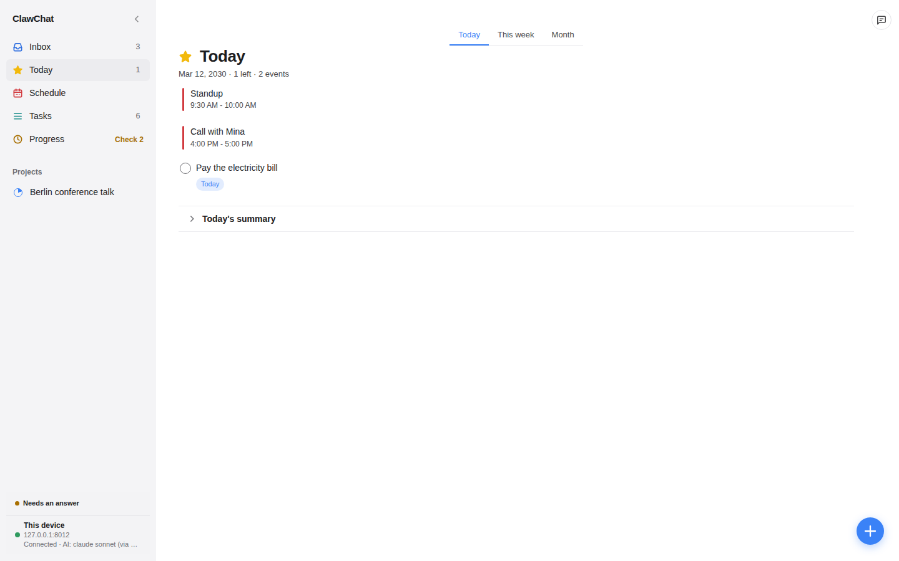</picture></td>
  </tr>
  <tr>
    <td>한 줄 적으면 작업, 메모, 날짜가 있는 알림 중 하나로 알아서 정리됩니다. 정리하지 못한 것은 버튼 두 개와 함께 기다립니다.</td>
    <td>오늘 마감, 밀린 것, 오늘의 일정, 그리고 달력이 제안하는 일. 대신 추가된 것은 한곳에서 되돌릴 수 있습니다.</td>
  </tr>
  <tr>
    <td align="center"><b>프로젝트</b></td>
    <td align="center"><b>진행</b></td>
  </tr>
  <tr>
    <td><picture><source media="(prefers-color-scheme: dark)" srcset="docs/media/web-project-flow-dark.png">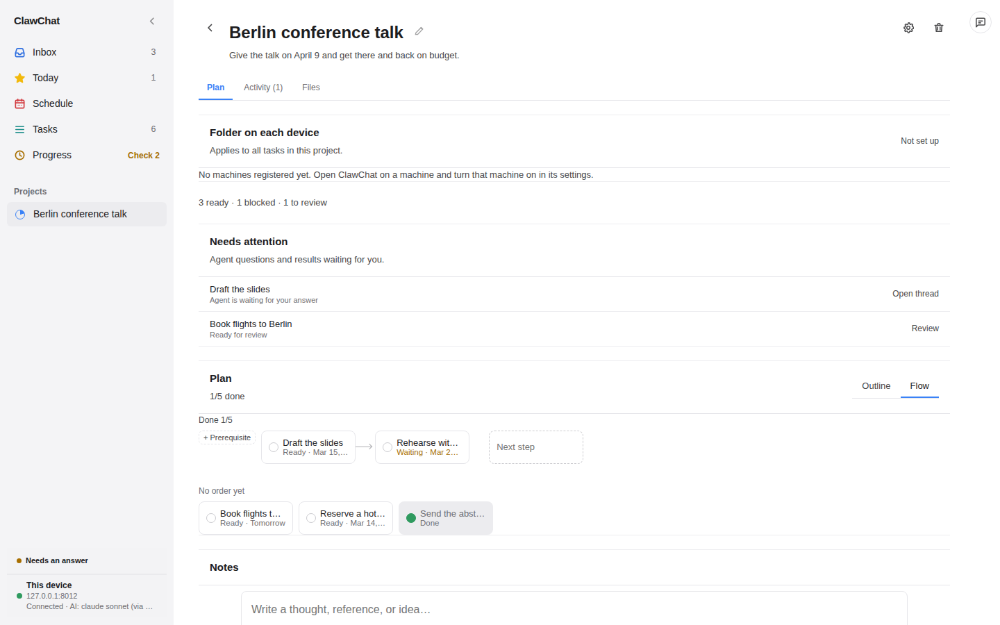</picture></td>
    <td><picture><source media="(prefers-color-scheme: dark)" srcset="docs/media/web-attention-dark.png">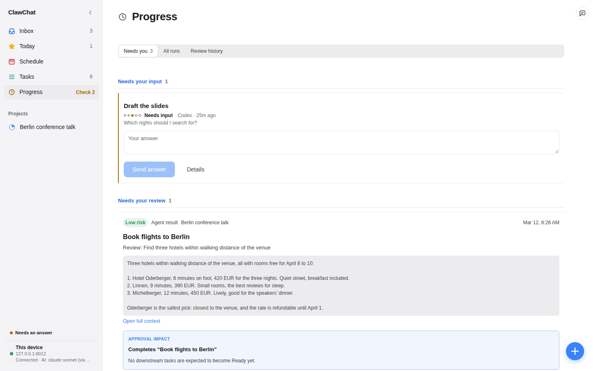</picture></td>
  </tr>
  <tr>
    <td>단계를 왼쪽에서 오른쪽으로, 무엇이 무엇을 막는지 함께 그립니다. 프로젝트가 돌아갈 기기별 폴더와, 나를 기다리는 에이전트의 질문과 결과도 여기에.</td>
    <td>사람이 필요한 것만: 그 자리에서 답할 질문, 승인할 저위험 결과, 다시 시도할 실패한 실행. 실행 기록과 검토 이력은 탭 하나 옆에 있습니다.</td>
  </tr>
  <tr>
    <td align="center"><b>일정</b></td>
    <td align="center"><b>채팅</b></td>
  </tr>
  <tr>
    <td><picture><source media="(prefers-color-scheme: dark)" srcset="docs/media/web-week-dark.png">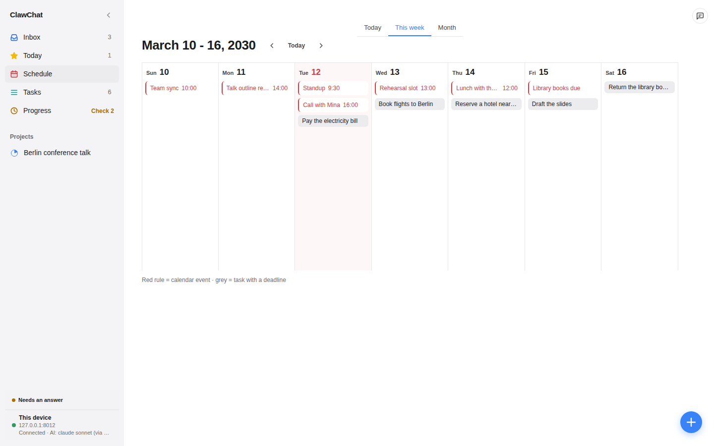</picture></td>
    <td><picture><source media="(prefers-color-scheme: dark)" srcset="docs/media/web-chat-dark.png">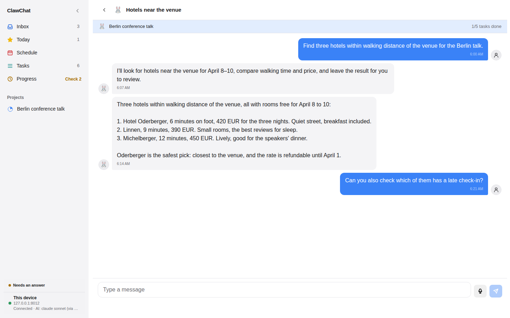</picture></td>
  </tr>
  <tr>
    <td>내 달력(CalDAV, Google)과 작업 마감을 나란히. 마감이 있는 일에는 비어 있는 시간을 찾아 줍니다.</td>
    <td>말로 무엇이든 부탁하세요. 대화는 프로젝트에 속할 수 있고, 에이전트의 결과는 검토할 수 있게 그 대화에 도착합니다.</td>
  </tr>
</table>

화면은 시스템 테마를 따릅니다. 위 화면 모두 다크 버전이 있으니 GitHub를 다크로 바꿔 보세요.

## 폰과 데스크톱

<p align="center">
  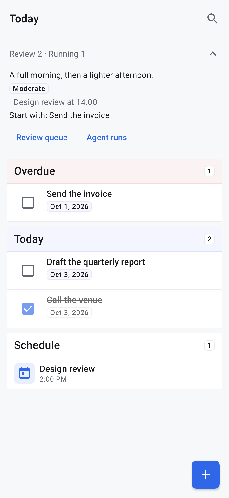
  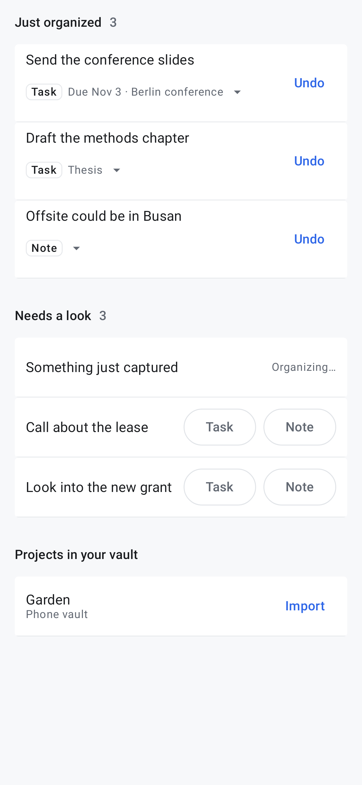
  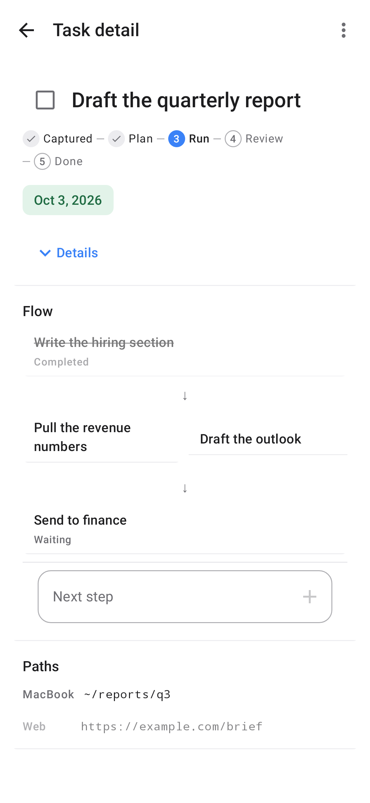
  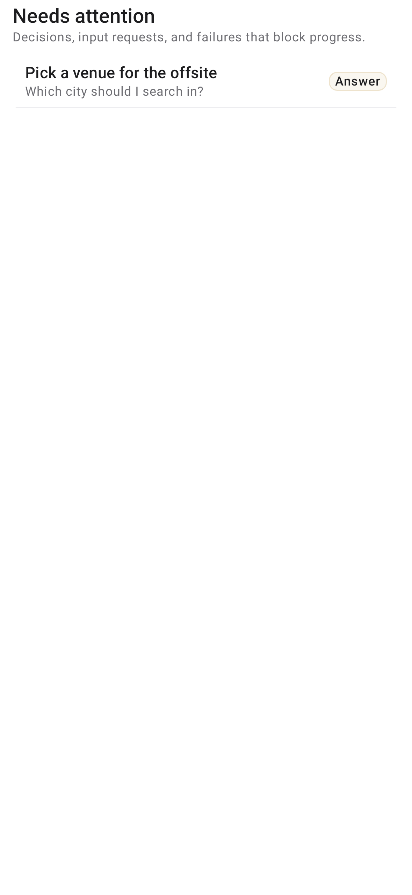
  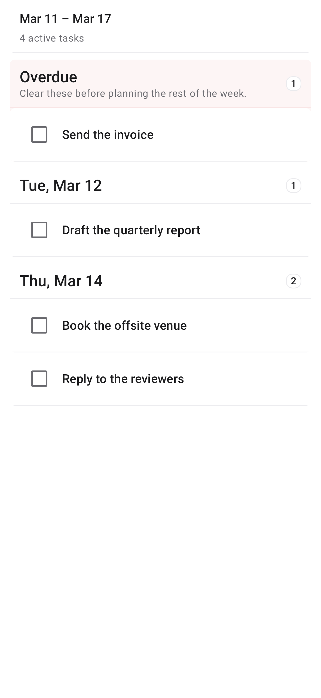
</p>

- **안드로이드**는 네이티브 앱입니다. 달력, 알림, 공유로 캡처, 홈 화면 위젯이 있는 오프라인 할 일 앱으로 혼자 써도 되고, 서버와 짝지으면(6자리 코드 또는 QR) 공유 프로젝트, 채팅, 검토, 에이전트 실행까지 씁니다. 에이전트의 질문에 답하거나 저위험 결과를 승인하는 일은 알림에서 바로 됩니다.
- **데스크톱**(Linux, macOS, Windows)은 같은 화면을 네이티브 창에 담고 서버를 함께 품고 있어, 설치 하나가 완전한 작업 공간입니다. 데스크톱 앱은 워커가 될 수도 있습니다. 그 기기로 보낸 실행은 그 기기에서, 프로젝트 폴더 안에서만 쓰며 돌아갑니다.
- **웹**은 서버가 내어 주는 같은 화면입니다. 네트워크 안의 어떤 브라우저에서든 열립니다.

## 어떻게 돌아가나

모든 작업은 다섯 단계를 지나고, 모든 화면이 같은 다섯 단계를 보여 줍니다. **캡처 → 계획 → 실행 → 검토 → 완료**.

1. **캡처.** 어느 기기에서든 받은함에 적습니다. 작업, 메모, 날짜 있는 알림으로 정리되고, 정리되지 않은 것은 탭 한 번을 기다립니다.
2. **계획.** 프로젝트를 선행 조건이 있는 단계로 짭니다. "기다리는 중"은 계산해 주므로 다음에 할 작업을 짐작할 필요가 없습니다.
3. **실행.** 준비된 작업을 스킬 체인으로 실행합니다(계획, 조사, 초안, 요약, 코드 리뷰, 데이터 분석, 우선순위, 주간 리뷰, Obsidian 동기화, 또는 직접 만든 `SKILL.md`). 실행은 질문을 남기고 기다릴 수 있습니다.
4. **검토.** 결과를 봅니다. 읽기만 하는 스킬의 저위험 결과는 몇 번 승인하고 나면 자동으로 받아들일 수 있고, 무언가를 쓰는 결과는 늘 나를 기다립니다.
5. **완료.** 이 작업에 기대던 것들이 풀립니다.

그 둘레에서: 달력은 CalDAV로 양방향 동기화되고, 다가오는 시험·마감·회의에서 할 일을 제안하며, Obsidian 보관함을 에이전트에 읽기 전용으로 공유할 수 있고, 예약 자동화가 같은 체인을 정해진 시간에 돌립니다.

## 받기

| 플랫폼 | 다운로드 |
|---|---|
| Linux | [최신 릴리스](https://github.com/Topasm/clawchat/releases/latest)의 `.AppImage` 또는 `.deb` |
| macOS (Apple silicon) | [최신 릴리스](https://github.com/Topasm/clawchat/releases/latest)의 `.dmg` |
| Windows | [최신 릴리스](https://github.com/Topasm/clawchat/releases/latest)의 `-setup.exe` |
| Android | [최신 릴리스](https://github.com/Topasm/clawchat/releases/latest)의 `.apk`, 이후 앱이 스스로 업데이트합니다 |

데스크톱 빌드는 서명되어 있지 않습니다. macOS는 처음 한 번 **시스템 설정 → 개인정보 보호 및 보안**에서 허용을 요구합니다.

**Docker로 서버 띄우기** (웹과 안드로이드 클라이언트가 여기에 연결합니다):

```bash
cp .env.example .env     # PIN과 AI 프로바이더 설정
docker compose up --build -d
```

로컬 모델은 `--profile ollama`, 비공개 웹 검색은 `--profile search`를 더하세요. [배포 문서](docs/deployment.md)를 보세요.

**소스에서** (Node.js ≥ 22, Python ≥ 3.11, uv 0.10.2):

```bash
make setup
make dev                 # 웹 :5173, API :8000
```

AI 기능에는 Ollama, OpenAI 호환 엔드포인트, Claude Code, Codex CLI, Codex API 중 하나가 필요합니다. 나머지는 없어도 동작합니다.

## 프라이버시

ClawChat은 내가 고른 기기 위의 FastAPI 프로세스 하나와 SQLite 데이터베이스 하나이고, PIN 뒤에 있습니다. 달력 비밀 주소는 암호화해 저장합니다. 공유 폴더는 경로와 제목만 색인하고 내용은 절대 읽지 않습니다. 내 기기에서 도는 에이전트 실행은 프로젝트 폴더에 갇히고, 어딘가에 쓰는 결과는 내 승인을 기다립니다. 계정도, 텔레메트리도, 중간의 클라우드도 없습니다.

## 문서

문서는 영어로 쓰여 있습니다.

- [설정 가이드](docs/setup.md): 에이전트 도구(웹 검색, MCP 서버), 내 스킬, CalDAV와 Google 달력, 안드로이드의 두 모드, `make` 타깃
- [배포](docs/deployment.md): Docker, 환경 변수, 프로덕션 설정
- [아키텍처](docs/architecture.md)와 [플랫폼 매트릭스](docs/architecture/platform-matrix.md)
- [백엔드 가이드](docs/backend-guide.md), [프론트엔드 가이드](docs/frontend-guide.md), [API 설계](docs/api-design.md)
- [데스크톱 릴리스](docs/desktop-release.md), [안드로이드 릴리스](docs/android-release.md)
- [README 미디어](docs/readme-media.md): 위 스크린샷이 만들어지는 방법
- [그 밖의 모든 것](docs/README.md)

## 라이선스

[MIT](LICENSE)
